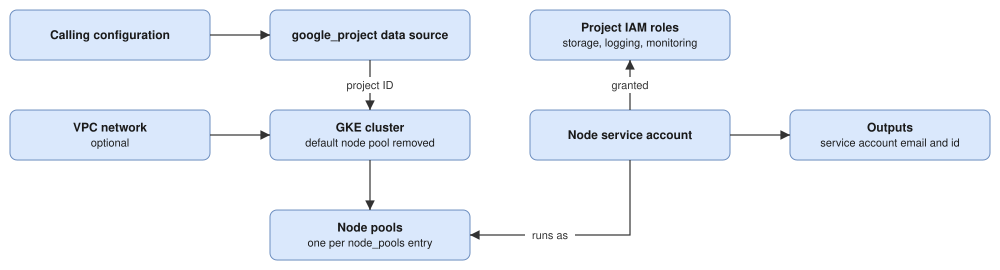

# Project Plan

## Overview

This repository is a reusable Terraform module, published to the Terraform registry as `iqz-systems/gke-cluster/google`, that creates a Google Kubernetes Engine cluster with Workload Identity, a dedicated node service account and separately managed node pools. The current goals are to fix the defects found in the review of 2026-11-01 without breaking existing callers, to expose the outputs and settings that callers need, to add repository tooling that keeps the module and its documentation consistent, and to prepare a deliberate major release for the changes that cannot be made compatibly.

## Technology Decisions

| Layer | Choice | Rationale |
| ----- | ------ | --------- |
| Infrastructure language | Terraform (HCL) | The module is consumed from the Terraform registry by Terraform configurations. |
| Provider | `hashicorp/google` `>=7.12.0` | Required for `secret_sync_config` and the other cluster attributes the module sets. |
| Node pool management | Separate `google_container_node_pool` resources, with the default pool removed | Node pools can be changed or replaced without recreating the cluster. |
| Networking | Dataplane V2 (`ADVANCED_DATAPATH`) with VPC-native IP allocation | Provides network policy enforcement without a separate add-on. |
| Identity | Workload Identity and a dedicated node service account | Workloads authenticate as Google service accounts without node-level keys. |
| Tests | `terraform test` with `mock_provider "google"` and `command = plan` | The tests run without credentials or a GCP project. |

## Architecture Overview

The calling configuration supplies the inputs. The module resolves the project through the `google_project` data source and uses that project ID for every resource. It creates a node service account with project IAM roles, an optional VPC network, the GKE cluster, and one node pool for each entry in `node_pools`. Every node pool runs as the node service account. The module currently outputs only the service account email and ID.

## Notes

- 2024-01-25: Node pools take their own zones through `node_pool_node_zones`, separate from the cluster's `cluster_node_zones`.
- 2025-01-13: The module can create its own VPC network or use an existing one through `create_vpc_network` and `vpc_network`.
- 2025-02-25: The default maintenance window is Saturday and Sunday from 02:00 to 08:00 UTC, and it can be removed by setting `maintenance_window` to null.
- 2025-12-08: The Gateway API is enabled on the standard channel by default.
- 2026-10-19: New attributes on `node_pools` are declared with `optional(..., default)`, so that existing callers keep working without changes. New inputs will follow the same rule, and their defaults will reproduce the current behaviour.
- 2026-11-01: Changes that would break existing callers (F11, F12) are held for a single major release, so that callers migrate once. All other backlog items will be released as minor versions. The user approved this plan and release grouping on 2026-11-01.
- 2026-11-01: For F2, a missing `vpc_network` with `create_vpc_network = false` will be a hard error from a precondition on the cluster, while a `vpc_network` ignored because `create_vpc_network = true` will produce a warning from a `check` block. A hard error in the second case would break existing callers' plans. A precondition is used instead of a cross-variable validation, which would require Terraform 1.9; the `check` block requires Terraform 1.5, which is below the 1.7 already required by the tests.

## Verification Plan

- Every change will be covered by plan-time tests in `tests/*.tftest.hcl`, run with `terraform init -backend=false && terraform test`. Each defect (F1 to F4) will first receive a test that fails against the current code, and the fix will be complete when that test passes.
- Input validation will be tested with `expect_failures = [var.<name>]`, including a passing case for each valid combination.
- Every change will pass `terraform fmt -check -recursive` and `terraform validate`. Once F10 is complete, these checks and the tests will also run in CI on every pull request.
- Behaviour that only the GCP API enforces, such as the service account ID length and the authorized networks block limit, will additionally be checked with `terraform plan -lock=false` from an example configuration against a non-production project before each release.
- The README's Usage, Inputs and Outputs sections will be checked against `variables.tf` and `outputs.tf` for every change to an input or output.

## Backlog

> **Legend**: `[ ]` = not started, `[~]` = partially implemented, `[x]` = complete (move it to Completed)

### Defects

- [ ] F3: Prevent service account ID overflow. **Exists**: `account_id = "${var.cluster_name}-sa"` in `main.tf`; service account IDs are limited to 6 to 30 characters, so a cluster name longer than 27 characters plans successfully and fails at apply. **Missing**: an optional `node_service_account_id` input that defaults to `"${cluster_name}-sa"`, and a validation that the resulting ID matches `^[a-z][a-z0-9-]{4,28}[a-z0-9]$`. Add tests for a long cluster name with and without the override.
- [ ] F4: Make the module-created VPC usable. **Exists**: `google_compute_network.vpc_network` is an auto-mode network with no subnetwork managed by the module, while `subnetwork` remains a required input whose only working value is the auto-created regional subnet. **Missing**: a decision between creating a custom-mode network with a subnetwork and secondary ranges (making `subnetwork` optional when the module creates the network) and removing network creation in the next major release. This decision needs the user's input before implementation.

### Outputs and configuration

- [ ] F5: Add cluster outputs. **Exists**: only `service_account_email` and `service_account_id` in `outputs.tf`. **Missing**: outputs for the cluster `name`, `id`, `location` and `endpoint`, `master_auth[0].cluster_ca_certificate` (marked sensitive), the network name, and the node pool names. Document them in the README.
- [ ] F6: Update the node service account roles. **Exists**: `roles/storage.objectViewer`, `roles/logging.logWriter` and `roles/monitoring.metricWriter` at project level in `main.tf`. **Missing**: grant `roles/container.defaultNodeServiceAccount` and `roles/artifactregistry.reader` instead. Removing `roles/storage.objectViewer` can break callers who still pull from Container Registry, so it will be controlled by an input that defaults to keeping the role until the major release.
- [ ] F7: Remove redundant OAuth scopes. **Exists**: `gke.tf` sets `cloud-platform` and six narrower scopes that it already includes. **Missing**: keep only `https://www.googleapis.com/auth/cloud-platform`; remove the obsolete `disable-legacy-endpoints` metadata entry. Confirm with a plan against an existing cluster that the change does not force node pool replacement before releasing it as a minor version; if it does, move it to the major release.
- [ ] F8: Allow named secondary ranges for pods and services. **Exists**: `ip_allocation_policy` sets the fixed netmasks `/16` and `/22`. **Missing**: optional `cluster_secondary_range_name` and `services_secondary_range_name` inputs; when they are null, the current netmasks are used. Add tests for both modes.
- [ ] F9: Expose fixed settings as optional inputs. **Exists**: cluster `resource_labels` contain only `project`; logging components include `WORKLOADS`; node pools use `max_surge = 1` and `max_unavailable = 0`; secure boot is not enabled; `max_pods_per_node` is not set. **Missing**: an optional `resource_labels` map merged with the `project` label, an optional `logging_components` list, optional per-pool `max_surge`, `max_unavailable`, `max_pods_per_node` and `enable_secure_boot` attributes, and validations that `min_node_count <= max_node_count` and that pool names are unique. Every default will reproduce the current behaviour.

### Repository tooling

- [ ] F10: Add CI, documentation generation and examples. **Nothing exists**: there is no CI, no `examples/` directory, no CHANGELOG and no `required_version`. **Missing**: `required_version = ">= 1.7"` in `main.tf`; a GitHub Actions workflow running `terraform fmt -check -recursive`, `terraform validate`, `tflint` and `terraform test`; `terraform-docs` generating the README's Inputs and Outputs sections, with a CI check that the README is current; an `examples/basic` configuration that the registry will display; and a CHANGELOG. Simplify `deletion_protection = var.disable_deletion_protection == true ? false : true` to `!var.disable_deletion_protection`, and add descriptions to `subnetwork`, `private_cluster_config` and `master_authorized_networks_config`.

### Major release

- [ ] F11: Key node pools by name. **Exists**: `google_container_node_pool.node_pool` uses `count` over `var.node_pools`, so removing or reordering an entry recreates every pool after it. **Missing**: `for_each` keyed by `name`, release notes with the `terraform state mv` commands callers must run (for example from `module.gke_cluster.google_container_node_pool.node_pool[0]` to `module.gke_cluster.google_container_node_pool.node_pool["app-nodes"]`), and a test that removing the first pool leaves the second pool's address unchanged.
- [ ] F12: Rename `disable_deletion_protection` to `deletion_protection` (default `true`), remove `roles/storage.objectViewer` by default (see F6), and apply the outcome of F4 if network creation is removed. **Nothing exists** beyond the current inputs.
- [ ] F13: Replace the deprecated default node pool removal. **Exists**: `gke.tf` sets `initial_node_count = 1` and `remove_default_node_pool = true`; with the resolved provider (`hashicorp/google` 8.9.0, allowed by `>=7.12.0`) every plan warns that `remove_default_node_pool` is deprecated and that clusters on 1.36.4-gke.1469000 or later should omit `initial_node_count` and `node_config` (or set `initial_node_count = 0`) instead. **Missing**: confirm the minimum cluster version callers run, decide whether the module's provider constraint should move to `>= 8`, switch to the new form, and check with a plan against an existing cluster that the change does not force the cluster to be replaced; if it does, keep it in this major release.

## Completed

- [x] F0a: Support for disabling deletion protection. Completed 2024-01-26.
- [x] F0b: Private nodes and per-node-pool zones. Completed 2024-01-25.
- [x] F0c: Service account ID output. Completed 2024-06-21.
- [x] F0d: Implied provider configuration. Completed 2024-08-21.
- [x] F0e: Optional VPC creation and existing VPC support. Completed 2025-01-13.
- [x] F0f: Private cluster configuration and master authorized networks. Completed 2025-01-23.
- [x] F0g: Weekend maintenance window. Completed 2025-02-25.
- [x] F0h: Subnetwork input. Completed 2025-03-26.
- [x] F0i: Gateway API enabled by default. Completed 2025-12-08.
- [x] F0j: Secret Manager add-on and secret sync configuration. Completed 2026-08-28.
- [x] F0k: Zonal clusters, node labels and taints, disk and image settings, initial node count, release channel, and plan-time tests. Completed 2026-10-19.
- [x] F1: Support more than one master authorized network. All entries in `master_authorized_networks_config` are now emitted as `cidr_blocks` inside a single `master_authorized_networks_config` block, which is omitted when the list is empty. Completed 2026-11-01.
- [x] F2: Validate the VPC network inputs. With `create_vpc_network = false` and no `vpc_network`, a precondition on the cluster now fails with a clear message; with `create_vpc_network = true` and `vpc_network` set, a `check` block warns that the value is ignored. The `network` expression no longer indexes an empty resource list. Completed 2026-11-01.

## Next Steps

1. F3: long cluster names fail only at apply, after the plan has been approved.
2. F5: callers need the cluster endpoint and CA certificate to configure the `kubernetes` and `helm` providers.

## Bugs Fixed During Verification

- 2026-11-01, F1: a plan with two or more entries in `master_authorized_networks_config` failed with "Too many master_authorized_networks_config blocks". **Cause**: `gke.tf` generated one `master_authorized_networks_config` block per list entry, and the provider allows at most one. **Fix**: a single block, present only when the list is non-empty, with a `dynamic "cidr_blocks"` over the list. **Test**: `multiple_authorized_networks` in `tests/master_authorized_networks.tftest.hcl` (with `no_authorized_networks_by_default` and `single_authorized_network` covering the other cases).
- 2026-11-01, F2: a plan with `create_vpc_network = false` and `vpc_network = null` failed with "Invalid index" on `google_compute_network.vpc_network.0.name`, and with `create_vpc_network = true` a supplied `vpc_network` was silently ignored. **Cause**: the `network` expression in `gke.tf` fell back to the module-created network whenever `vpc_network` was null, without checking `create_vpc_network`, and nothing validated the combination. **Fix**: `network` is selected by `create_vpc_network` alone, a cluster precondition requires `vpc_network` when `create_vpc_network` is false, and `check "vpc_network_ignored"` warns when the value is ignored. **Test**: `missing_vpc_network_rejected` and `ignored_vpc_network_warned` in `tests/network.tftest.hcl` (with `module_vpc_created_by_default` and `existing_vpc_used` covering the valid cases).

## Changelog

- 2026-11-01: Created the plan from the module review, with the architecture diagram, backlog F1 to F12 and the completed history from git.
- 2026-11-01: Plan approved; F1 started with a reproducing test.
- 2026-11-01: Added F13 for the deprecated remove_default_node_pool argument reported by provider 8.9.0.
- 2026-11-01: F1 completed; all 10 test runs pass. See Bugs Fixed During Verification.
- 2026-11-01: F2 started with a reproducing test; recorded the precondition and check block decision in Notes.
- 2026-11-01: F2 completed; all 14 test runs pass. See Bugs Fixed During Verification.
